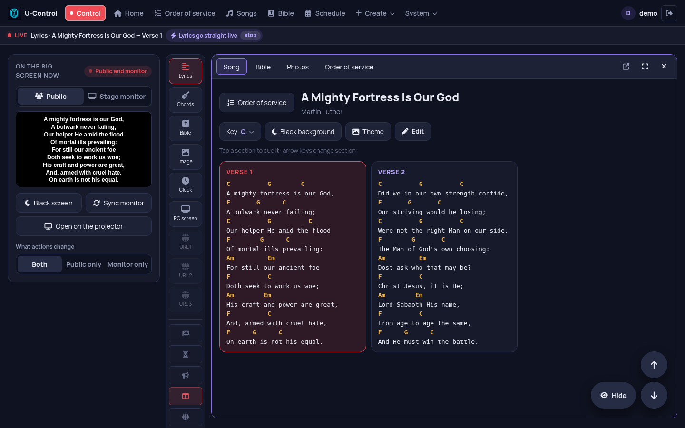
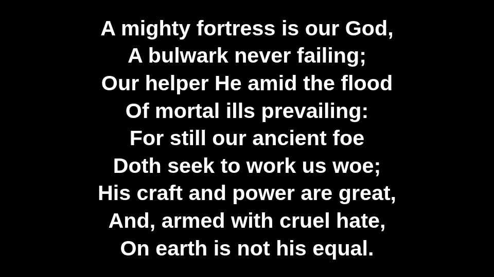
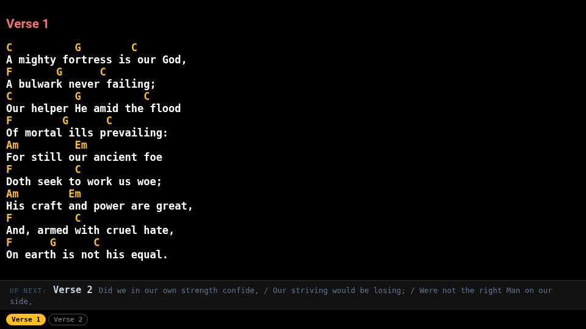
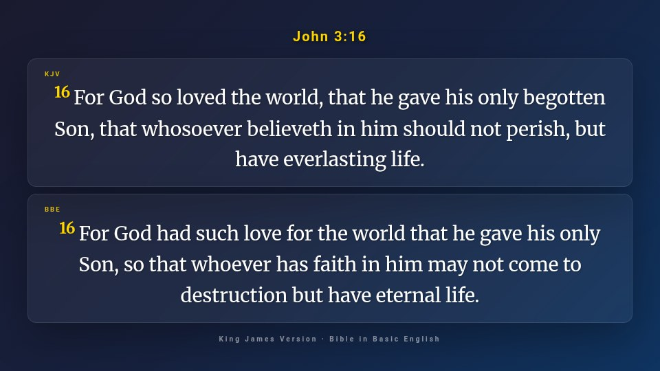
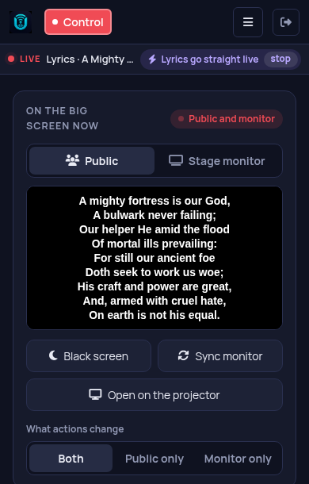

# U-Control

🇧🇷 [Português](README.md)

**Free, open-source church presentation software.** Lyrics with chords,
Bible, photos, videos, PowerPoint and the order of service on the big
screen, controlled from the browser on a PC, phone or tablet.

One computer runs U-Control (Windows, Raspberry Pi or Docker), and any
device on the same network opens the Control panel or the screens at
`http://<ip>:8585`. No internet needed during the service.

> **Language:** the interface is in English and Portuguese (System →
> Language). Automatic follows each person's browser.

**[⬇ Download for Windows](https://github.com/brunomint/U-Control/releases/latest)** · [Project website](https://brunomint.github.io/U-Control/en/) · [On AlternativeTo](https://alternativeto.net/software/u-control/about/)



| Big screen | Stage monitor (musicians) |
|---|---|
|  |  |
| **Bible in two versions** | **From your phone** |
|  |  |

## Features

- **Songs with chords:** the big screen shows only the lyrics and the
  stage monitor shows the chords, with the next section below. Each
  musician can transpose on their own device without changing anyone
  else's. Sheet music too.
- **Bible:** public-domain and openly licensed translations included
  (King James Version, Bible in Basic English and others), search by
  reference, and two versions on the screen at once.
- **Order of service and calendar:** each service's order opens the
  songs and readings in sequence.
- **Photos, videos and PowerPoint:** presentations with animations and
  transitions stay animated on the screen (converted with LibreOffice).
- **Screen sharing:** shows a computer's screen on the big screen over
  the network.
- **Website on the big screen** (Windows): opens a website full screen,
  and the Control panel scrolls, advances and zooms it.
- **Clock, countdown and announcements** scrolling at the bottom.
- **Stream Deck shortcuts** and other buttons, via web addresses.
- **Import songs** from OpenLP/OpenLyrics, OpenSong, ChordPro, Holyrics or plain
  text.
- **Backup**, and export/import of songs and services between
  installations.
- **Update notice** inside the app (Windows).
- **Interface in English and Portuguese.**

## Installation

### Windows

Download `U-Control-Setup-x.y.z.exe` from the
[Releases](https://github.com/brunomint/U-Control/releases/latest) page
and install it. The app lives in the Windows system tray (next to the
clock). Its menu opens the Control panel and the screens (big screen and
stage monitor), which go full screen on the second monitor.

Data is kept in `%APPDATA%\U-Control`. Installing a new version over the
old one keeps everything.

### Raspberry Pi / Linux

On Ubuntu, Debian, Linux Mint or Raspberry Pi OS (64-bit), one command
installs everything and starts U-Control with the computer:

```sh
curl -fsSL https://brunomint.github.io/U-Control/instalar.sh | bash
```

Running it again updates to the latest version (backing up the database
first). With `| bash -s -- --telao`, the big screen also opens full
screen when you log in to the desktop. The other options are at the top
of the [script](docs/instalar.sh).

To install by hand:

```sh
git clone https://github.com/brunomint/U-Control.git
cd U-Control
python3 -m venv venv
venv/bin/pip install -r requirements.txt
venv/bin/python scripts/patch_flask_socketio.py
./ucontrol.sh
```

`ucontrol.sh` applies the database migrations and starts gunicorn (see
`gunicorn.conf.py`); on the Pi it runs as a systemd service.
`ffmpeg` (system package) is used for PowerPoint videos and YouTube
audio; LibreOffice converts presentations. Also install the free fonts
that match the metrics of the Office fonts (Calibri, Cambria, Arial…),
otherwise slide text comes out wider and wraps:

```sh
sudo apt install ffmpeg libreoffice-impress fonts-crosextra-carlito fonts-crosextra-caladea fonts-liberation2
```

### Docker

The ready-made image (PC and Raspberry Pi 4/5, 64-bit) is
`ghcr.io/brunomint/u-control`. With
[`docker-compose.yml`](docker-compose.yml) in a folder:

```sh
docker compose up -d
```

Or directly, without compose:

```sh
docker run -d --name ucontrol --network host --restart unless-stopped \
  -v ./docker-data/instance:/app/instance \
  -v ./docker-data/imagens:/app/static/imagens \
  -v ./docker-data/audio:/app/static/audio \
  ghcr.io/brunomint/u-control:latest
```

Data is kept in `docker-data/`. To update: `docker compose pull` and
`docker compose up -d`. If you cloned the repository and want to run your
own code, use `docker compose up -d --build`.

### First login

On a new installation, the login screen asks you to create the first
user. Other people sign up later under **Usuários** (Users).

## Bibles

Only openly licensed or public-domain translations are included: the
King James Version (1769) and the Bible in Basic English in English, plus
Portuguese, Russian, Chinese and Arabic translations. Copyrighted
translations (NIV, ESV…) can be added by whoever has the right to use
them: see [bibles/LICENSES.md](bibles/LICENSES.md) (in Portuguese) for
the file format and folder.

## Development

```sh
venv/bin/pip install -r requirements-dev.txt
venv/bin/pytest
```

The Windows installer is built by GitHub Actions
(`.github/workflows/build-windows.yml`). A `vX.Y.Z` tag matching the
`VERSION` file publishes a Release.

## Contributing

Found a problem or have an idea? Open an
[issue](https://github.com/brunomint/U-Control/issues), in English or
Portuguese. Fixes and improvements via pull request are welcome. The
interface text lives in [`translations/en.json`](translations/en.json)
(Portuguese → English): better wording, or a new language, is a good
first contribution.

Like it? Give U-Control a like on [AlternativeTo](https://alternativeto.net/software/u-control/about/) — that is how other
churches looking for an OpenLP or ProPresenter alternative find it.

## License

[MIT](LICENSE) for the code. The included Bibles have the licenses listed
in [bibles/LICENSES.md](bibles/LICENSES.md).
