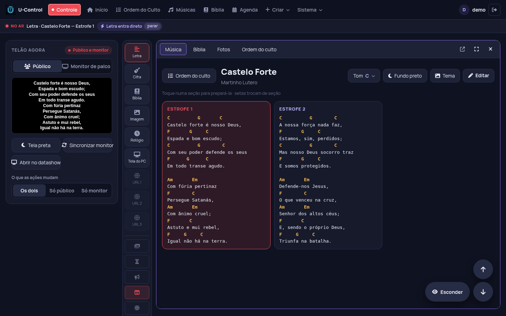
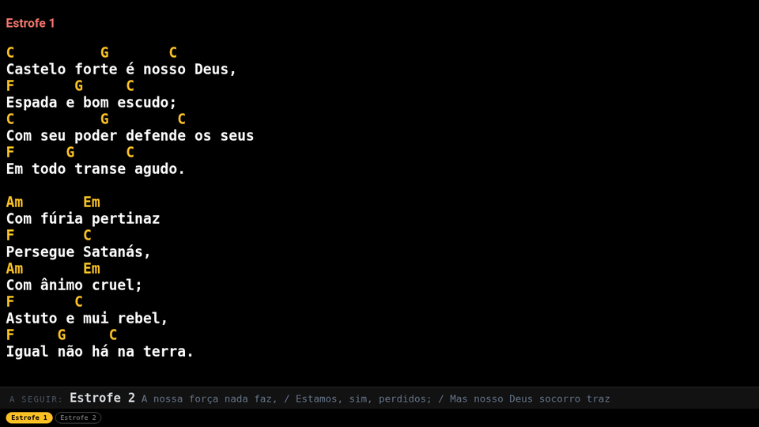
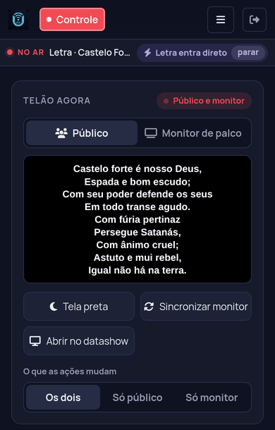

# U-Control

🇺🇸 [English](README.en.md)

**Projeção gratuita e de código aberto para igrejas.** Letras com cifra,
Bíblia, fotos, vídeos, PowerPoint e a ordem do culto no telão,
controlados pelo navegador do PC, do celular ou do tablet.

Um computador roda o U-Control (Windows, Raspberry Pi ou Docker) e
qualquer aparelho na mesma rede abre o Controle ou as telas pelo endereço
`http://<ip>:8585`. Não precisa de internet durante o culto.

**[⬇ Baixar para Windows](https://github.com/brunomint/U-Control/releases/latest)** · [Site do projeto](https://brunomint.github.io/U-Control/)



| Telão | Monitor de palco (músicos) |
|---|---|
|  |  |
| **Bíblia em duas versões** | **Pelo celular** |
|  |  |

## O que ele faz

- **Músicas com cifra:** o telão mostra só a letra e o monitor de palco
  mostra a cifra, com a próxima parte embaixo. Cada músico pode mudar o
  tom no próprio aparelho, sem mexer no dos outros. Também guarda partitura.
- **Bíblia:** traduções livres incluídas, busca por referência e duas
  versões ao mesmo tempo no telão.
- **Ordem do culto e agenda:** a ordem de cada culto abre as músicas e
  leituras na sequência.
- **Fotos, vídeos e PowerPoint:** apresentações com animação e transição
  continuam animadas no telão (convertidas pelo LibreOffice).
- **Tela do PC:** compartilha a tela de um computador no telão pela rede.
- **Site no telão** (Windows): abre um site em tela cheia e o Controle
  rola, avança e dá zoom.
- **Relógio, cronômetro e avisos** passando no rodapé.
- **Atalhos para Stream Deck** e outros botões, por endereço web.
- **Importar músicas** do Holyrics, OpenLP/OpenLyrics, ChordPro ou texto.
- **Backup** e exportar/importar músicas e cultos entre instalações.
- **Atualização** avisada no próprio programa (Windows).

## Instalação

### Windows

Baixe o `U-Control-Setup-x.y.z.exe` na página de
[Releases](https://github.com/brunomint/U-Control/releases/latest) e
instale. O programa fica na bandeja do Windows (ao lado do relógio), e
pelo menu dela você abre o Controle e as telas (telão e retorno de
palco), que vão para o segundo monitor em tela cheia.

Os dados ficam em `%APPDATA%\U-Control`. Instalar uma versão nova por
cima não apaga nada.

### Raspberry Pi / Linux

No Ubuntu, Debian, Linux Mint ou Raspberry Pi OS (64 bits), um comando
instala tudo e deixa o U-Control ligando junto com o computador:

```sh
curl -fsSL https://brunomint.github.io/U-Control/instalar.sh | bash
```

Rodar de novo atualiza para a última versão (com cópia do banco antes).
Com `| bash -s -- --telao`, o telão também abre em tela cheia ao entrar
na área de trabalho. As outras opções estão no começo do
[script](docs/instalar.sh).

Para instalar à mão:

```sh
git clone https://github.com/brunomint/U-Control.git
cd U-Control
python3 -m venv venv
venv/bin/pip install -r requirements.txt
venv/bin/python scripts/patch_flask_socketio.py
./ucontrol.sh
```

O `ucontrol.sh` aplica as migrations do banco e sobe o gunicorn (ver
`gunicorn.conf.py`); no Pi ele roda como serviço do systemd.
O `ffmpeg` (pacote do sistema) é usado para vídeos de PowerPoint e
áudio do YouTube; o LibreOffice, para converter apresentações. Instale
junto as fontes livres que substituem as do Office com as mesmas medidas
(Calibri, Cambria, Arial…), senão o texto dos slides sai mais largo e quebra:

```sh
sudo apt install ffmpeg libreoffice-impress fonts-crosextra-carlito fonts-crosextra-caladea fonts-liberation2
```

### Docker

A imagem pronta (PC e Raspberry Pi 4/5, 64 bits) fica em
`ghcr.io/brunomint/u-control`. Com o
[`docker-compose.yml`](docker-compose.yml) numa pasta:

```sh
docker compose up -d
```

Ou direto, sem o compose:

```sh
docker run -d --name ucontrol --network host --restart unless-stopped \
  -v ./docker-data/instance:/app/instance \
  -v ./docker-data/imagens:/app/static/imagens \
  -v ./docker-data/audio:/app/static/audio \
  ghcr.io/brunomint/u-control:latest
```

Os dados ficam em `docker-data/`. Para atualizar: `docker compose pull`
e `docker compose up -d`. Quem clonou o repositório e quer rodar o
próprio código usa `docker compose up -d --build`.

### Primeiro acesso

Numa instalação nova, a tela de login pede para criar o primeiro usuário.
Os outros se cadastram depois em **Usuários**.

## Bíblias

Vêm incluídas só traduções de licença aberta ou de domínio público, como
a Bíblia Livre e a Nova Bíblia Viva. Traduções com direitos autorais
(NVI, ACF, ARC...) podem ser adicionadas por quem tem o direito de usá-las:
veja [bibles/LICENSES.md](bibles/LICENSES.md).

## Desenvolvimento

```sh
venv/bin/pip install -r requirements-dev.txt
venv/bin/pytest
```

O instalador do Windows é montado pelo GitHub Actions
(`.github/workflows/build-windows.yml`). Uma tag `vX.Y.Z`, igual ao
arquivo `VERSION`, publica uma Release.

## Contribuir

Achou um problema ou tem uma ideia? Abra uma
[issue](https://github.com/brunomint/U-Control/issues). Correções e
melhorias por pull request são bem-vindas.

## Licença

[MIT](LICENSE) para o código. As Bíblias incluídas têm as licenças
listadas em [bibles/LICENSES.md](bibles/LICENSES.md).
